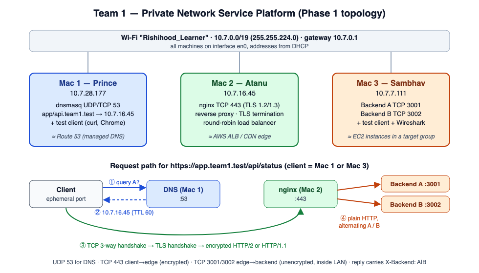

# Private Network Service Platform — Team 1

Computer Networks course project, **Phase 1: Build & Observe** and **Phase 2: Harden, Recover, and Troubleshoot**.
A fully local private service on three macOS laptops: own DNS → HTTPS edge (nginx) → two load-balanced backends, with every step proven by `dig`, `curl -v`, Wireshark and browser DevTools.

> *The application stays simple — the network is the project.*



| Machine | Member | Role | IP | Service / port |
|---|---|---|---|---|
| Mac 1 | Prince Kumar Singh | Private DNS + test client | 10.7.28.177 | dnsmasq UDP/TCP 53 |
| Mac 2 | Atanu Adhikari | Edge: reverse proxy, TLS termination, load balancer | 10.7.16.45 | nginx TCP 443 |
| Mac 3 | Sambhav Kumar | Backend A + Backend B + test client + Wireshark | 10.7.7.111 | TCP 3001, TCP 3002 |

Domain: `app.team1.test`, `api.team1.test` → 10.7.16.45 · Network: Wi-Fi `Rishihood_Learner`, 10.7.0.0/19, gateway 10.7.0.1.

Team on GitHub: Atanu Adhikari ([@techatanu](https://github.com/techatanu)) · Prince Kumar Singh ([@princesingh2024](https://github.com/princesingh2024)) · Sambhav Kumar ([@alGo-explO](https://github.com/alGo-explO)).

## Repository layout (mapped to spec section 9 deliverables)

```
.
├── README.md                     ← you are here
├── docs/
│   ├── Phase1_Report.md          ← Architecture document + Phase 1 report
│   ├── D3_Failure_Demo.md        ← form D3 answer (Option A) + run sheet
│   └── diagrams/topology.svg|png ← network topology + request flow
├── config/                       ← Configuration bundle
│   ├── mac1-dns/                 dnsmasq.conf + client DNS setup
│   └── mac2-edge/
│       ├── nginx/team1.conf      nginx reverse proxy / LB / TLS
│       └── tls/                  CA + server cert (public parts only) + setup notes
├── backend/                      ← Backend source code + launch instructions
│   └── backend.py
├── scripts/                      ← helper scripts (lb_test.sh, cache_test.sh)
└── evidence/                     ← Evidence folder
    ├── A-ping/  B-dns/  C-backends/  D-loadbalancing/
    ├── E-tls/   F-caching/  G-capture/
    └── failures/ 1-wrong-dns-server/ 2-wrong-dns-record/ 3-one-backend-stopped/
                  4-both-backends-stopped/ 5-wrong-port/
```

## Quick start

```bash
# Mac 1
sudo brew services restart dnsmasq
# Mac 3 (two windows)
python3 backend/backend.py A 3001
python3 backend/backend.py B 3002
# Mac 2
nginx -t && nginx
# any client Mac (Mac 3: use /usr/bin/curl)
dig app.team1.test
curl -v https://app.team1.test/api/status
./scripts/lb_test.sh
./scripts/cache_test.sh
```

## Phase 2: Harden, Recover, and Troubleshoot

Report: [`docs/Phase2_Report.md`](docs/Phase2_Report.md) · Troubleshooting guide: [`docs/ExtensionF_Troubleshooting_Guide.md`](docs/ExtensionF_Troubleshooting_Guide.md)

| Ext | What | Where | Test |
|---|---|---|---|
| A | Backup DNS on Mac 3 (same records) | `config/mac3-backup-dns/` | `scripts/phase2/test_extA_dns_failover.sh` |
| B | TTL 30 s + controlled record change | `config/mac1-dns/` (`team1.hosts`, `set_record.sh`) | `test_extB_ttl_cutover.sh` |
| C | pf: backends reachable only from the edge | `config/mac3-backends/pf_team1.conf` + enable/disable | `test_extC_firewall.sh` (sudo) |
| D | nginx HA failover | `config/mac2-edge/nginx/team1-phase2.conf` | `test_extD_ha_failover.sh` |
| E | Standby edge + DNS cutover | `config/mac3-standby-edge/` | `test_extE_edge_migration.sh` |
| F | Fault injector + 4-layer diagnosis | `scripts/phase2/inject_fault.sh`, `diagnose.sh` | `test_extF_faults.sh` |

Every test runs in **Mode 1** (whole system on one Mac, no sudo except pf) or **Mode 2** (`MODE=lan`, the three laptops).
Output is saved to `evidence/phase2/<ext>/<mode>_run.txt`.
Mac 2 switches its live nginx to Phase 2 with `./scripts/phase2/edge_phase2_install.sh install` (and `rollback`).

### Mac 2 (Atanu) instructions for Phase 2 on the LAN

> **Phase 2 IPs (DHCP changed them after Phase 1):** Mac 1 = **10.7.23.243**, Mac 2 = 10.7.16.45 (unchanged), Mac 3 = **10.7.24.9**. The table at the top shows the Phase 1 addresses. All Phase 2 configs read the IPs from `scripts/phase2/lan.env` and the files listed in `docs/Phase2_Report.md` section 2.

```bash
sudo networksetup -setdnsservers Wi-Fi 10.7.23.243 10.7.24.9   # Ext A: primary + backup DNS
sudo dscacheutil -flushcache; sudo killall -HUP mDNSResponder
./scripts/phase2/edge_phase2_install.sh install     # live nginx -> Phase 2 config (rollback: ... rollback)
tail -f /opt/homebrew/var/log/nginx/team1_access.log  # shows $upstream_addr + up_status during Ext D
```
- AirDrop `/opt/homebrew/etc/nginx/certs/app.team1.test.key` to Sambhav (standby edge, Ext E). It is never put in git.
- Share configuration files with Prince and Sambhav (`config/mac1-dns` and `config/mac3-*`).
- Ext C: from Mac 2, `curl -m 3 http://10.7.24.9:3001/api/status` must still return 200 while the firewall is on (the edge is allowed).
- Ext E: when the test asks, stop the primary edge (`nginx -s stop`), then start it again (`nginx`).
- Ext F fault testing on the edge: `MODE=lan ./scripts/phase2/inject_fault.sh tls-cert-mismatch | tcp-port-blocked [edge|backend] | restore` (Mac 1 runs `./mac1.sh diagnose`).
- Evidence collection: test outputs are recorded in `evidence/phase2/lan/` and documented in `docs/Phase2_Report.md`.

Private keys are **not** in this repository (see `.gitignore`). They stay on Mac 2 only.

-- End of README.md --
