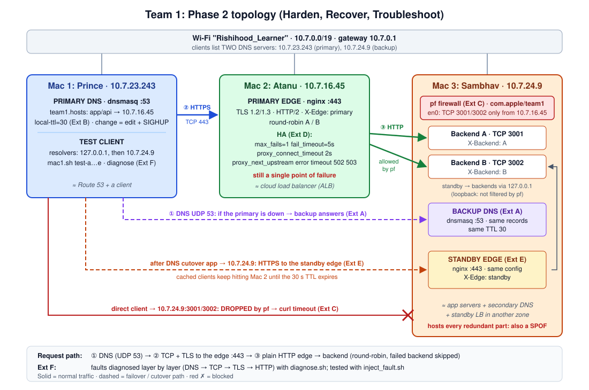

# Phase 2 Report: Harden, Recover, and Troubleshoot (Team 1)

Computer Networks course project, Phase 2 (spec section 7). Team: Prince Kumar Singh (Mac 1), Atanu Adhikari (Mac 2), Sambhav Kumar (Mac 3).
Phase 2 **extends** the Phase 1 network ([Phase1_Report.md](Phase1_Report.md)); nothing was rebuilt.

> **Status of the evidence.** Every number below was produced by the test scripts and is copied from the files in [`evidence/phase2/`](../evidence/phase2/).
> - **Mode 1 (local simulation):** all services run on one Mac (Mac 2) with the same config files. Final runs dated 23 Nov 2026, 00:04–01:00 IST.
>   In Mode 1 the edge is `127.0.0.1` and the "other" address (`ALT_IP`) is simply this Mac's own Wi-Fi address, which happens to be 10.7.16.45. In the Mode 1 logs, 10.7.16.45 therefore plays the *non-edge client source* (Ext C) and the *standby edge* (Ext E). It does **not** mean Mac 2's role in the LAN.
> - **Mode 2 (physical LAN):** run on 23 Nov 2026 with all three laptops (run 1 at 02:20, runs 2–4 at 14:22–15:20). Every failed LAN run is kept in the evidence and explained below.

---

## 1. Architecture: updated for Phase 2



IPs for Phase 2. DHCP gave Mac 1 and Mac 3 new addresses after Phase 1 (the old ones are in [Phase1_Report.md](Phase1_Report.md)). Mac 2 is unchanged. If they change again, run `scripts/phase2/set_lan_ips.sh <mac1> <mac2> <mac3>`.

| Machine | Member | IP (Phase 2) | Phase 1 role | **Added in Phase 2** |
|---|---|---|---|---|
| Mac 1 | Prince | 10.7.23.243 | primary DNS (dnsmasq :53), test client | TTL 30 s, records in `team1.hosts` (Ext B); runs the client-side tests |
| Mac 2 | Atanu | 10.7.16.45 | edge: nginx TLS :443, round-robin LB | HA failover tuning (Ext D), `X-Edge` header, fault-injection target (Ext F) |
| Mac 3 | Sambhav | 10.7.24.9 | Backend A :3001, Backend B :3002 | **backup DNS** :53 (Ext A), **pf firewall** (Ext C), **standby edge** nginx :443 (Ext E) |

```
                       ┌──────────── Mac 1 10.7.23.243 ───────────┐
   client  ─① DNS──────▶│ dnsmasq PRIMARY  app/api → 10.7.16.45 TTL30│
   (Mac 1)  │ (fails over)└───────────────────────────────────────────┘
            └─① DNS────▶┌──────────── Mac 3 10.7.24.9 ─────────────────────────────┐
                        │ dnsmasq BACKUP (same records, TTL 30)                     │
            ┌─② TCP/③ TLS/④ HTTP (normal) ──▶ Mac 2 nginx :443 ── pf allows ──▶ :3001 A / :3002 B
            │                                 10.7.16.45      (only from Mac 2)    │
            └─ after DNS cutover (Ext E) ───▶ Mac 3 nginx :443 (standby) ─127.0.0.1─▶ A / B
                        │ pf: TCP 3001/3002 on Wi-Fi accepted ONLY from 10.7.16.45  │
                        └────────────────────────────────────────────────────────────┘
```

Request flow (unchanged per layer): **DNS** (UDP 53, now two servers) → **TCP** 3-way handshake to the edge :443 → **TLS** 1.2/1.3 (cert `app.team1.test`, Team1 Local CA) → **HTTP/2** to nginx → plain HTTP to a backend chosen by round-robin, **skipping a failed backend** (Ext D).

## 2. What changed from Phase 1

| Area | Phase 1 | Phase 2 | File |
|---|---|---|---|
| DNS records | `host-record=` lines, TTL **60** | `addn-hosts=team1.hosts`, TTL **30**; change = edit + `SIGHUP` (no restart) | [`config/mac1-dns/dnsmasq.conf`](../config/mac1-dns/dnsmasq.conf), [`team1.hosts`](../config/mac1-dns/team1.hosts) |
| DNS redundancy | Mac 1 only | + **backup dnsmasq on Mac 3**, same records; clients list `10.7.23.243 10.7.24.9` | [`config/mac3-backup-dns/`](../config/mac3-backup-dns/) |
| Edge HA | `fail_timeout=10s`, `proxy_connect_timeout 2s` | `max_fails=1 fail_timeout=5s`, `proxy_connect_timeout 2s` (1s in LAN runs 1–3, see Ext D), `proxy_next_upstream error timeout http_502 http_503`, `proxy_next_upstream_tries 2`, `proxy_next_upstream_timeout 5s`, `X-Edge` header, `up_status` in the log | [`config/mac2-edge/nginx/team1-phase2.conf`](../config/mac2-edge/nginx/team1-phase2.conf) (replaces `team1.conf` via [`edge_phase2_install.sh`](../scripts/phase2/edge_phase2_install.sh)) |
| Isolation | backends reachable from any LAN host | **pf**: 3001/3002 accepted only from Mac 2; rollback script | [`config/mac3-backends/pf_team1.conf`](../config/mac3-backends/pf_team1.conf), `enable_firewall.sh`, `disable_firewall.sh` |
| Edge redundancy | one edge | **standby nginx on Mac 3** (same config; backends via 127.0.0.1) | [`config/mac3-standby-edge/nginx-standby.conf`](../config/mac3-standby-edge/nginx-standby.conf) |
| Troubleshooting | manual | 4-layer `diagnose.sh` + `inject_fault.sh` + guide | [`scripts/phase2/`](../scripts/phase2/), [`ExtensionF_Troubleshooting_Guide.md`](ExtensionF_Troubleshooting_Guide.md) |

**Test harness ([`scripts/phase2/lib.sh`](../scripts/phase2/lib.sh)).** Every test has two modes.
- **Mode 1** builds its configs *from the real LAN files*. Only addresses, ports and paths are swapped:
  - backends → 127.0.0.1
  - DNS → 127.0.0.1:5300 (primary) and :5301 (backup), plus a caching dnsmasq on :5302 that stands in for the client's mDNSResponder
  - edge → 127.0.0.1:8443, standby edge → the Mac's en0 IP
  - Port 5353 is avoided because macOS uses it for mDNS.
- **Mode 2** (`MODE=lan`) uses the real IPs from [`lan.env`](../scripts/phase2/lan.env), and pauses to tell each teammate what to do.

Teammate packages: `dist/mac1-prince-dns.zip`, `dist/mac3-sambhav-backends-backupdns.zip` (one `mac1.sh` / `mac3.sh` entry point each, plus a README run-sheet; private keys never included).

## 3. Resilience tests and results

| Ext | Test script | Mode 1 result | Mode 2 (LAN) result |
|---|---|---|---|
| A | `test_extA_dns_failover.sh` | **12/12 pass** | **7/7 pass** ([run 1](../evidence/phase2/lan/mac1/run1_20261123/extA/lan_run.txt)) |
| B | `test_extB_ttl_cutover.sh` | **7/7 pass** | **7/7 pass** ([run 2, 14:42](../evidence/phase2/lan/mac1/run2_20261123/extB/lan_run.txt)); run 1 was 5/7, a test-timing fault |
| C | `test_extC_firewall.sh` (sudo) | **7/7 pass** | **7/7 pass** ([run 1](../evidence/phase2/lan/mac1/run1_20261123/extC/lan_run.txt)) |
| D | `test_extD_ha_failover.sh` | **4/4 pass** | **4/4 pass** ([run 5, 15:31, final config](../evidence/phase2/lan/mac1/run3_20261123/extD_lan_run.txt)); run 4 also 4/4; run 1 was 3/4 (window-counting fault), run 3 was 2/4 (14 failed requests, Wi-Fi SYN loss with a 1 s connect timeout) |
| E | `test_extE_edge_migration.sh` | **10/10 pass** | **10/10 pass** ([run 2, 14:48](../evidence/phase2/lan/mac1/run2_20261123/extE/lan_run.txt)); run 1 was 4/9 (standby edge not started) |
| F | `test_extF_faults.sh` (sudo) | **9/9 pass** (4 faults, each blamed on the right layer) | LAN test run: DNS and TLS faults blamed on the right layer ([log](../evidence/phase2/lan/mac1/run1_20261123/extF_lan_from_session.txt)); healthy again at 15:19 ([log](../evidence/phase2/lan/mac1/run2_20261123/mac1/session_20261123.txt)) |
| packages | `test_mac3_package.sh` / `test_mac1_package.sh` | **24/24** / **33/33** | n/a |

### Ext A: Backup DNS resolver ([evidence](../evidence/phase2/extA/local_run.txt))
- Primary and backup both returned `app.team1.test. 30 IN A 127.0.0.1` (Mode 1 edge address).
- With the primary stopped, `dig` to it: `connection timed out; no servers could be reached`. After flushing the client cache, the client still resolved the name, and the backup's log shows `query[A] app.team1.test from 127.0.0.1`. HTTPS returned **200**.
- **App failure** (both backends stopped): the name resolved, `connect=0.000480s tls=0.002581s`, and the edge returned **HTTP 502** (connection refused on loopback; on the LAN the same failure gave 504, see below).
- **DNS failure** (both DNS servers stopped): no A record, so the client never opens a connection, while the edge itself still answered 200 when reached by IP.
- **LAN, run 1 (23 Nov 2026, 02:21), 7/7 pass** ([evidence](../evidence/phase2/lan/mac1/run1_20261123/extA/lan_run.txt)):
  - Mac 1's resolver list was `127.0.0.1` (its own primary) then `10.7.24.9` (backup). Both servers answered `app.team1.test. 30 IN A 10.7.16.45`.
  - With the primary stopped (`./mac1.sh dns-stop`), `dig` showed `SERVER: 10.7.24.9#53`, and HTTPS returned **200** (`x-backend: B`, `x-edge: primary`).
  - **App failure** (`./mac3.sh backends-stop`): the name still resolved, but the edge returned **HTTP 504**, not 502. Mac 2's nginx log: `-> 10.7.24.9:3002, 10.7.24.9:3001 … 504 up_status=504, 504`. Mac 3 silently dropped the SYNs to the closed ports (macOS firewall stealth mode) instead of answering RST, so nginx hit `proxy_connect_timeout 1s` (504) instead of "connection refused" (502).
  - **DNS failure** (backends up, both DNS servers stopped): `connection timed out; no servers could be reached`, and curl got `HTTP 000`, i.e. no connection was ever attempted.

### Ext B: TTL and controlled record change ([evidence](../evidence/phase2/extB/local_run.txt))
- The authoritative answer carries the configured TTL: `app.team1.test. 30 IN A 127.0.0.1`.
- The record was changed to 10.7.24.9, and the server answered the new IP at once. The **client cache kept the old answer** while its TTL counted down: `t=+0s 127.0.0.1 ttl-left=29` → `t=+15s … 14` → `t=+27s … 2`.
- At **`t=+30s`** (polled every 3 s) the client got `10.7.24.9` with a fresh TTL of 30.
- **Manual flush:** the record was changed back. Right after the change the client still said `10.7.24.9 (cached)`. Right after the flush (SIGHUP to the cache, the Mode 1 equivalent of `sudo dscacheutil -flushcache; sudo killall -HUP mDNSResponder`) it said `127.0.0.1`, **immediately**.
- **LAN, run 1: 5/7** ([evidence](../evidence/phase2/lan/mac1/run1_20261123/extB/lan_run.txt)). The two failed checks are a fault in the test, not in DNS:
  - The client cached the answer at about 02:27:23. Prince and Sambhav then typed `dns-set` at 02:27:39 and 02:27:57, so the test's next lookup came **more than 30 s later**. The 30 s TTL had already expired, and the client correctly showed the new IP at once.
  - Fix: on Mac 1 the test now changes the primary record itself, with no human pause (the client asks Mac 1 first). Sambhav changes the backup beforehand.
- **LAN, run 2 (14:42): 7/7 pass** ([evidence](../evidence/phase2/lan/mac1/run2_20261123/extB/lan_run.txt)). Sambhav changed the backup first; then the test on Mac 1 changed the primary itself.
  - The client kept the **old cached 10.7.16.45 from t=+0 s to t=+36 s**, and got the new 10.7.24.9 at **t=+39 s**.
  - The macOS system cache (mDNSResponder) held the answer 6–9 s longer than the 30 s TTL. Run 2a (14:26) measured the same: old until t=+36 s, new at t=+40 s. That run failed only because the test's limit was 35 s; the LAN limit is now TTL + 15 s, and run 2a stays in the evidence. We did not find out why macOS keeps the answer longer. Mode 1's dnsmasq cache switched at t=+30 s.
  - Change back + manual flush: the client said `10.7.24.9 (cached)` right after the change and `10.7.16.45` right after `sudo dscacheutil -flushcache; sudo killall -HUP mDNSResponder`.

### Ext C: Service isolation with pf ([evidence](../evidence/phase2/extC/local_run.txt))
- **Before:** `http://<en0-ip>:3001` → 200 (a client could bypass the edge).
- **Firewall on:** rules loaded into anchor `com.apple/team1`:
  `pass in quick on lo0 inet proto tcp from 127.0.0.1 to any port = 3001/3002 … keep state`, then `block drop in quick on lo0 proto tcp from any to any port = 3001/3002`.
  - Through the edge: 6/6 requests 200, alternating A/B.
  - Direct to 3001 and 3002: `curl: (28) Failed to connect … after 3006 ms: Timeout was reached`.
- **Rollback:** anchor empty, *"main ruleset identical to the rollback copy: OK"*, pf back to `Disabled`, direct access 200 again.
- **LAN, run 1 (02:40), 7/7 pass** ([Mac 1](../evidence/phase2/lan/mac1/run1_20261123/extC/lan_run.txt), [Mac 3 session](../evidence/phase2/lan/mac3/run1_20261123/session_20261123.txt)):
  - Before: `direct http://10.7.24.9:3001 -> HTTP 200` from Mac 1.
  - Rules loaded on Mac 3: `pass in quick on en0 inet proto tcp from 10.7.16.45 to any port = 3001/3002 … keep state`, then `block drop in quick on en0 proto tcp from any to any port = 3001/3002`.
  - Through the edge: 6/6 requests 200, alternating A/B. Direct from Mac 1: `curl: (28) Failed to connect to 10.7.24.9 port 3001 after 3002 ms` (the same for 3002).
  - Rollback: *"anchor com.apple/team1 is empty: OK"*, *"main ruleset identical to the rollback copy: OK"*, pf `Disabled`, direct access 200 again.

### Ext D: High-availability failover ([evidence](../evidence/phase2/extD/local_run.txt))
- Continuous HTTPS traffic at 5 requests per second. Backend A was stopped after request 11 (03:13:14). The counted outage window was requests 12–51; the window ends *before* the restart command, and A was restarted after request 52 (03:13:23).
- **96 requests, 0 failed (non-200).**
- While A was down: **40 requests, 40 served by B (100 %).**
- The nginx log shows the retries that hid the failure from the client:
  - `127.0.0.1 -> 127.0.0.1:3001, 127.0.0.1:3002 [23/Nov/2026:03:13:14] … 200 up_status=502, 200`: the first attempt went to dead A, nginx retried on B, and the client got 200.
  - `… [23/Nov/2026:03:13:20] … 200 up_status=502, 200`: 6 s later the 5 s `fail_timeout` had expired, so nginx probed A again. A was still dead, and the request was again retried on B.
- After the restart, A served again from request 64 (03:13:26), and A and B alternated until the end.
- **LAN, run 1 (02:37): 333 requests, 0 failed** ([Mac 1](../evidence/phase2/lan/mac1/run1_20261123/extD/lan_run.txt), [Mac 2 nginx log](../evidence/phase2/lan/mac2/run1_20261123_team1_access.log), [Mac 3 session](../evidence/phase2/lan/mac3/run1_20261123/session_20261123.txt)):
  - Sambhav ran `kill-a` at 02:37:51 and `revive-a` at 02:39:11 (Mac 3 session log). Between those times Mac 1 sent **164 requests: 164 served by B, 0 failed** (counted from the timestamps in the traffic log).
  - Mac 2's nginx log shows the retries: `-> 10.7.24.9:3001, 10.7.24.9:3002 [02:37:57] … 200 up_status=504, 200`, repeated about every 8 s (02:38:05, :12, :20, :28 …) as the 5 s `fail_timeout` expired and nginx probed dead A again.
  - A served again from 02:39:18 (7 s after the revive, which matches the 5 s penalty), then A and B alternated.
  - **LAN run 3 (15:09): 208 requests, 14 failed** (2/4). Mac 2's nginx log shows why: at 15:09:36, with A killed, nginx tried **B** and got no TCP connection within `proxy_connect_timeout 1s` (`-> 10.7.24.9:3002, 10.7.24.9:3001 … 504 up_status=504, 504`). With `max_fails=1`, both servers were then marked failed for 5 s, and the next 13 requests got `502` from `team1_backends` (no live upstream). B was healthy before and after. One SYN lost on Wi-Fi is retransmitted by macOS after about 1 s, so a 1 s connect timeout turns a single lost packet into an outage. Run 1 shows the same thing on a healthy A (one `up_status=504, 200` at 02:37:05).
    - Fix: `proxy_connect_timeout 2s` (covers one SYN retransmit, and is the Phase 1 value) and `proxy_next_upstream_timeout 5s`, so a 2 s failed attempt on A still leaves time for the retry on B. Trade-off: the one request every `fail_timeout` that probes a dead A now waits up to 2 s instead of 1 s. Not yet verified on the LAN (see run 4).
  - The test itself scored 3/4. It counted the "A down" window until Prince pressed Enter, about 19 s after the real revive, so 14 requests that A served *after* it came back fell inside the window. Fix: the window now ends before the revive prompt.
  - **LAN run 4 (15:16): 4/4 pass, 132 requests, 0 failed; in the counted outage window 40 of 40 were served by B** ([Mac 1](../evidence/phase2/lan/mac1/run2_20261123/extD/lan_run.txt), [Mac 2 log](../evidence/phase2/lan/mac2/run2-3_20261123_afternoon_team1_access.log)).
    - Mac 2's log shows the hidden retries: `-> 10.7.24.9:3001, 10.7.24.9:3002 [15:16:44] … 200 up_status=504, 200`, and again at 15:16:51, 15:16:58, 15:17:07, 15:17:14. The error log has `upstream timed out (60: Operation timed out) while connecting to upstream … 10.7.24.9:3001` at the same times.
    - **Caveat:** this run still used the **1 s** connect timeout. The install of the 2 s config at 15:15 did not reach the running nginx. It was started from a restricted (sandboxed) shell that could not see or signal the running nginx process (`bind() to 0.0.0.0:443 failed (48: Address already in use)`), and the script then put the Phase 1 file back on disk. `edge_phase2_install.sh` now rolls back only when `nginx -t` fails, and `status` warns when the Phase 2 file is not what is on disk. Atanu then re-installed from Terminal.app (15:27: `nginx reloaded`, `OK: only the Phase 2 config is on disk`).
  - **LAN run 5 (15:31), with the final 2 s config: 4/4 pass, 106 requests, 0 failed; in the counted outage window 40 of 40 were served by B** ([Mac 1](../evidence/phase2/lan/mac1/run3_20261123/extD_lan_run.txt), [Mac 2 access log](../evidence/phase2/lan/mac2/run5_20261123_1531_team1_access.log), [error log](../evidence/phase2/lan/mac2/run5_20261123_1531_nginx_error.log)).
    - Sambhav ran `kill-a` at 15:31:49 and `revive-a` at 15:32:20. Mac 2 retried on B at 15:31:50, 15:31:58, 15:32:06 and 15:32:14: `-> 10.7.24.9:3001, 10.7.24.9:3002 … 200 up_status=502, 200`.
    - This time dead A **refused** the connection (`connect() failed (61: Connection refused)`, so 502 at once) instead of silently dropping the SYN (504 after the connect timeout), as in runs 1, 3 and 4. We did not find out what changed on Mac 3. So run 5 shows the final config working with 0 errors, but no lost-SYN event happened during it to exercise the 2 s timeout.

### Ext E: Controlled edge migration ([evidence](../evidence/phase2/extE/local_run.txt))
- Primary edge 127.0.0.1:8443 (`X-Edge: primary`); standby edge 10.7.16.45:8443 (`X-Edge: standby`); same config.
- Record changed to the standby: a **new lookup got the standby at once**. The **cached client kept the old answer**: TTL left 30 → 27 → … → 2, every request still `edge=primary`.
- At **t=+31 s** (TTL 30, polled every 3 s) the client switched: `200 backend=A edge=standby`.
- The primary edge was then stopped, and a check confirmed it was really down (not 200). The client still got **200** through the standby. The record was rolled back.
- **LAN, run 1: 4/9, not a valid run.** `./mac3.sh standby-on` stopped with "Missing … app.team1.test.key": the private key (AirDrop only, never in the zip) was not in `config/mac3-standby-edge/certs/`, so no standby edge existed. The cutover also suffered from the same human-pause > TTL problem as Ext B.
  - Fixes: a clear missing-key message, an Application Firewall allow for nginx on Mac 3, the record change done by Mac 1 itself, and a check that the primary edge is really down after `nginx -s stop`.
- **LAN, run 2 (14:48): 10/10 pass** ([Mac 1](../evidence/phase2/lan/mac1/run2_20261123/extE/lan_run.txt), [standby access log](../evidence/phase2/lan/mac3/run2_20261123/collected_20261123-152020/standby_edge_access.log)):
  - Both edges served: `primary edge 10.7.16.45: 200 … edge=primary`, `standby edge 10.7.24.9: 200 … edge=standby`.
  - After the cutover a new lookup got 10.7.24.9 at once. The cached client stayed on `edge=primary` from t=+0 s to t=+35 s and moved to `edge=standby` at **t=+38 s**.
  - Atanu stopped nginx on Mac 2. The test confirmed the primary edge was down, and the client still got **200 via 10.7.24.9**. The standby's log shows Mac 1's requests: `10.7.23.243 -> 127.0.0.1:3002 [14:50:54] … 200 … edge=standby`.

### Ext F: Fault injection / diagnosis ([evidence](../evidence/phase2/extF/local_run.txt))
`inject_fault.sh` broke the running system four times. After each fault, `diagnose.sh` checked DNS → TCP → TLS → HTTP and stopped at the first failing layer. After each restore, all four layers were healthy again.

| Fault injected | diagnose.sh verdict | Key evidence line |
|---|---|---|
| none (baseline) | all healthy (0) | `HTTP 200 backend=B edge=primary` |
| `dns-wrong-ip` | **DNS (1)** | `app.team1.test. 30 IN A 10.7.31.250` but the edge is 127.0.0.1 |
| `tls-cert-mismatch` | **TLS (3)** | `curl: (60) SSL: no alternative certificate subject name matches target host name 'app.team1.test'`; cert `CN=wrong.team1.test`, issuer Team1 Local CA |
| `tcp-port-blocked edge` (pf) | **TCP (2)** | handshake to :8443 timed out (SYNs dropped) |
| `tcp-port-blocked backend` (pf) | **HTTP (4)** | DNS, TCP and TLS OK; edge returned **504**, then **502** on the next request (both backends marked failed) |

LAN: in the evaluation the faculty injects the fault; Mac 1 diagnoses with `./mac1.sh diagnose`. **Our LAN test run (02:42–02:45)** ([log](../evidence/phase2/lan/mac1/run1_20261123/extF_lan_from_session.txt)):

| Step | diagnose verdict on Mac 1 | Key evidence line |
|---|---|---|
| healthy | all four layers OK | `HTTP 200 backend=A edge=primary` |
| Atanu: `inject_fault.sh tls-cert-mismatch` | **TLS (3)** | `subject=… CN=wrong.team1.test`, `curl: (60) SSL: no alternative certificate subject name matches target host name 'app.team1.test'` |
| Prince: `./mac1.sh fault-dns` | **DNS (1)** | `app.team1.test. 30 IN A 10.7.31.250` but the edge is 10.7.16.45 |
| `fault-restore`, then `./mac1.sh status` | 6/6 pass | `https://app.team1.test works (200, no -k)` |

After both restores, `./mac1.sh diagnose` at 15:19:42 reported all four layers healthy: `[OK] certificate trusted and valid for app.team1.test`, `HTTP 200 backend=A edge=primary` ([log](../evidence/phase2/lan/mac1/run2_20261123/mac1/session_20261123.txt)).

## 4. Troubleshooting findings

Things we ran into while building and testing Phase 2, all observed in our own runs:
1. **Health checks have memory.**
   - After both backends died and came back, the edge still answered **502 for up to 5 s**. nginx had marked both servers failed for `fail_timeout=5s`, and our first Ext A run failed on exactly this.
   - Lesson: recovery time = process restart + `fail_timeout`.
2. **`dig` lies about caching.** `dig` asks the server directly and bypasses the OS cache. The server always returns a fresh TTL (30). To observe cached/stale answers we used a caching resolver (Mode 1) or `dscacheutil -q host` (Mode 2).
3. **Timeout vs refused tells you the layer.**
   - pf `block drop` gives the client a **timeout** (curl exit 28). A stopped service gives **connection refused** (exit 7, a RST).
   - Behind the edge, the same two cases show up as **504** and **502**.
4. **Two configs in `servers/` break nginx.** Homebrew's `nginx.conf` includes `servers/*`. The Phase 1 and Phase 2 files both define `upstream team1_backends`, so the Phase 2 file must *replace* the Phase 1 one (`edge_phase2_install.sh` swaps them and rolls back if `nginx -t` fails).
5. **pf on macOS: use an anchor and a token.**
   - Rules go into `com.apple/team1`, which the default `/etc/pf.conf` already evaluates, so `/etc/pf.conf` is never edited.
   - pf is enabled with `pfctl -E` (a reference-counted token) and released with `pfctl -X`. Rollback therefore restores the exact previous state; the rollback check printed "main ruleset identical to the rollback copy".
6. **Test isolation matters.** Two local tests started at the same time killed each other's services, because they share ports. The harness now refuses to run two at once.

## 5. Remaining single points of failure (Ext D question)

- **Edge (Mac 2).** `app.team1.test` resolves to one IP. If Mac 2 or its nginx dies, every request fails although both backends are healthy.
  Production fixes:
  - **Two edges sharing a virtual IP with VRRP (keepalived):** failover in seconds, with no DNS change.
  - **DNS failover / round-robin with health checks** (Route 53 failover records, short TTL): bounded by the TTL and client caches. This is what Ext E demonstrates manually.
  - **A managed cloud load balancer** (AWS ALB, GCP LB).
- **Mac 3 itself.** It hosts both backends, the backup DNS and the standby edge (our 3-person team combines roles, as spec section 3 allows). Losing that laptop removes the redundancy Phase 2 added. A 4-laptop team would put Backend B on Mac 4.

## 6. Learning summary (one paragraph per extension)

**Ext A: Backup DNS.** DNS is the very first dependency of every request. If no resolver answers, the client cannot even start a TCP connection, however healthy the servers behind it are. A second resolver with identical records, listed second on every client, turns a total outage into a short retry delay. We learned to tell a DNS failure (no IP, `curl: (6)`) apart from an application failure (DNS, TCP and TLS succeed, nginx returns 502), and that both servers must be changed together or clients that fail over get different answers.

**Ext B: TTL and record change.** The TTL is the server's permission to cache. After a record change each client keeps the old answer for up to one TTL, and flushing the cache only fixes that one machine. A short TTL (30 s) makes migrations fast but costs more queries. In production the TTL is lowered well before a planned cutover. In our Mode 1 run the cached answer survived one TTL (switch at t=+31 s, polling every 3 s), and a manual flush made the change visible immediately.

**Ext C: Service isolation.** Backends should not be reachable by clients at all, only by the edge. A pf rule that passes TCP 3001/3002 from the edge's IP and silently drops everything else enforces this at the network layer, independent of the application. Our Mode 1 run showed the edge still served A and B while a direct connection timed out after about 3 s (`curl: (28) … after 3006 ms`). We also learned to keep a rollback copy and verify that the original ruleset is back after the demo.

**Ext D: HA failover.** nginx's passive health check (`max_fails=1 fail_timeout=5s`) together with `proxy_next_upstream` lets the edge retry a failed request on the other backend inside the same client request. In our run the client saw 0 errors in 96 requests while A was down for 40 of them. The trade-off is the penalty window: a recovered backend gets traffic again only after `fail_timeout`. The edge remains a single point of failure.

**Ext E: Edge migration.** Moving traffic between edges by changing DNS is simple and needs no new hardware, but it is not instant. New lookups move immediately, while clients with a cached answer stay on the old edge until their TTL runs out (exactly 30 s in our run). Therefore the old edge must stay up for at least one TTL before it is drained.

**Ext F: Troubleshooting.** Checking the layers in order (DNS → TCP → TLS → HTTP) finds the real fault instead of a symptom. A wrong DNS IP also *looks* like a TCP timeout, and a backend firewall looks like an HTTP 504. The error type itself is evidence: refused vs timeout, curl exit 60 for a certificate name mismatch, 502 vs 504. In our Mode 1 test run, `diagnose.sh` named the right layer for all four injected faults (DNS, TCP, TLS, HTTP); on the LAN we tested the DNS and TLS faults.

## 7. How to reproduce

```bash
# Mode 1, one Mac (each test starts and stops its own services):
./scripts/phase2/test_extA_dns_failover.sh
./scripts/phase2/test_extB_ttl_cutover.sh
./scripts/phase2/test_extC_firewall.sh        # Terminal.app (sudo)
./scripts/phase2/test_extD_ha_failover.sh
./scripts/phase2/test_extE_edge_migration.sh
./scripts/phase2/test_extF_faults.sh          # Terminal.app for the pf faults
# Mode 2, LAN: Mac 2 ./scripts/phase2/edge_phase2_install.sh install ; Mac 3 ./mac3.sh start ;
#              Mac 1 ./mac1.sh start && ./mac1.sh test-a … test-e
```
